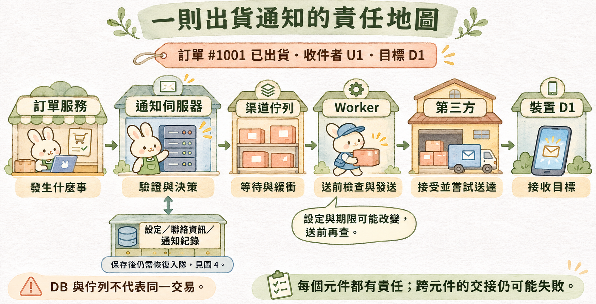
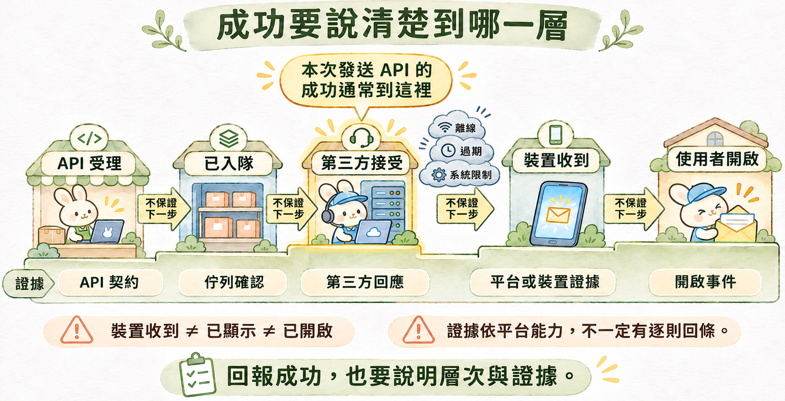
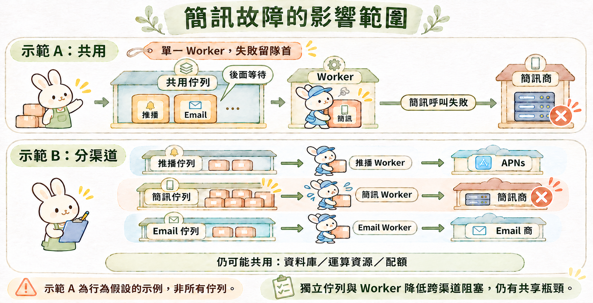
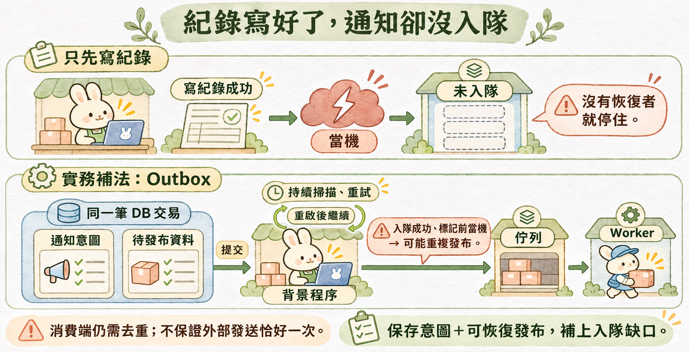
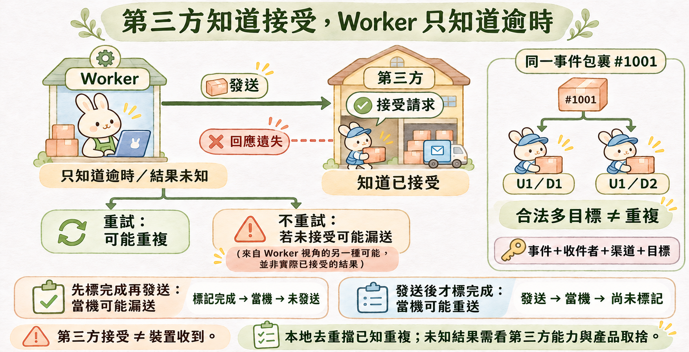
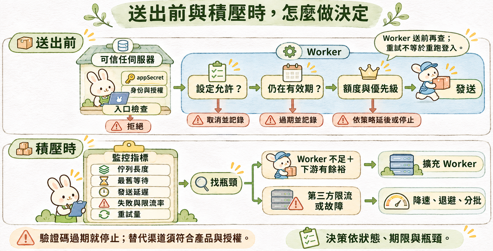

# 第 10 章段落總結圖內容草稿

主要教材為 [Claude 分享 artifact](https://claude.ai/artifact/8MZBkes36fAX7Kd1zM77E2)，依 2026-11-06 線上七站內容規劃。本地教材已嵌入六張獨立插畫，使用內建 image_gen 生成並逐張檢查；教學位置、限制、講師提問與解答保留。線上分享頁未修改。圖片與重製提示詞存於 `assets/chapter-10-summary/`，後續圖片以圖 1 為風格參考。

## 共用規則

- 沿用訂單 #1001 已出貨、使用者 U1、裝置 D1。需要跨渠道比較時才加入同場景的驗證碼簡訊與行銷 Email。
- 保留既有快遞類比，但技術元件名稱為主，類比只當輔助。
- 所有圖的元件名稱與相對位置一致；當前重點突出，其他元件簡化。
- 每張圖回答一個問題，保留一項限制與一句結論。講師先遮住結論讓讀者預測，再揭露。
- 動畫負責展開過程，總結圖負責停留、回想與課後複習。已有圖能完成任務時，直接整合或替換。
- 「本章設計」「實務補充」「示範假設」分清楚。Outbox、結果未知與監控判斷等實務補充不冒充書中規定。

## 圖 1：一則出貨通知的責任地圖

**放置位置。** 第 2 站「追蹤一則通知」走查後、成功狀態整理前。與開場既有的「通知系統是一條管線」共用同一套構圖；不要再新增一張內容相同的流程圖。開場先看簡版，第 2 站補上責任。

**要回答的問題。** 從訂單出貨到裝置收到，各元件到底負責哪一件事？

圖上標示「事件：訂單 #1001 已出貨」「收件者 U1」「目標 D1」。通知紀錄旁保留「保存後仍需恢復入隊，見圖 4」；Worker 旁保留「排隊期間設定與期限可能改變，送前再查」。本圖是責任地圖，不表示資料庫與佇列已具備原子性。

**圖下結論。** 每個元件都有責任；跨元件的交接仍可能失敗。

**講師提問。** 通知伺服器已接受請求，能回報「使用者看到了」嗎？

**預期答案。** 不能。後續入隊、第三方接受、裝置收到與使用者開啟仍需各自證據。

## 圖 2：成功要說清楚到哪一層

**放置位置。** 第 2 站，整合現有「成功是哪一層」表格，改成可停留的狀態階梯。保留表格作文字替代，不另外重複一大段解說。

**要回答的問題。** 後端顯示成功，為什麼手機可能沒通知？

每個箭頭都加「不保證下一步」的說明，避免畫成必然一路成功。第三方與裝置之間標出「離線、過期、系統限制」；裝置收到不等於已顯示，顯示也不等於已開啟。證據是否可取得依平台能力，不暗示所有平台都有逐則送達回條。

**圖下結論。** 回報成功時，同時說出是哪一層，以及依據什麼。

**講師提問。** APNs 已接受，使用者卻沒看到，這兩件事矛盾嗎？

**預期答案。** 不矛盾，第三方接受不保證後續裝置顯示。

## 圖 3：簡訊故障的影響範圍

**放置位置。** 第 4 站「把收件和送出拆開」頁，替換既有前後對照圖並承接上一頁的佇列動畫。共用模式與分渠道模式並排。

**要回答的問題。** 分渠道後，什麼被隔離，什麼還是共用？

故障標記只放在簡訊商與該渠道的積壓。底部用共享區塊標示剩餘依賴，不把其他渠道畫成「保證正常」。共用模式的隊首阻塞明確標為示範假設，不推廣成所有 Queue 的行為。

**圖下結論。** 獨立佇列與 Worker 降低跨渠道阻塞，不能消除所有共享瓶頸。

**講師提問。** 三條佇列分開了，但三種 Worker 耗盡同一個資料庫連線池，其他渠道會受影響嗎？

**預期答案。** 會；故障隔離還取決於共享資源的使用方式與容量。

## 圖 4：紀錄寫好了，通知卻沒入隊

**放置位置。** 第 5 站「三道保險」中，緊接通知紀錄說明。取代現有 Outbox 純文字折疊內容的主要示意；詳細補充仍可折疊。

**要回答的問題。** 資料留下來後，誰確保它會再次被處理？

用交易邊界框住 DB 內兩份資料，不能把佇列畫進同一筆 DB 交易。額外標記「入隊成功後、標記發布前當機，仍可能重複發布」。

**圖下結論。** 保存通知意圖，加上可恢復的發布程序，才補上這個入隊缺口。

**講師提問。** Outbox 發布成功，但尚未標記已發布就當機，重啟會怎樣？

**預期答案。** 可能再次發布，消費端仍需去重；Outbox 不等於外部發送恰好一次。

## 圖 5：第三方知道成功，Worker 卻只知道逾時

**放置位置。** 第 5 站，接在去重示範之後，整合現有「第三方接受後回應遺失」補充。沿用第 2 站的「回應遺失」動畫作動態版本。

**要回答的問題。** 為什麼有事件 ID，還不能保證使用者只收到一次？

將「實際發生什麼」與「Worker 知道什麼」分開。旁邊附小對照：先標記完成再發送，當機可能漏送；發送後才標記，當機可能重送。不要把「第三方接受」畫成「裝置一定收到」。

角落以同一事件向 U1／D1、U1／D2 發送為例，標出「合法多目標不等於重複」，提醒去重粒度需依事件、收件者、渠道與目標定義。

**圖下結論。** 本地去重能擋已知重複；外部結果未知時，還要看第三方能力與產品取捨。

**講師提問。** 重試時換一個新事件 ID，能解決重複嗎？

**預期答案。** 不能，反而可能繞過去重；同一次發送的重試要沿用識別值。

## 圖 6：送出前與積壓時，怎麼做決定

**放置位置。** 第 7 站收尾，整合現有三則通知結局表與監控段落，作為全章最後的判斷圖。第 3 站的櫃台檢查圖保留，只在旁邊提示「Worker 送前仍需再查設定與期限」。

**要回答的問題。** 系統能送時，該不該送？送不動時，又該改哪裡？

身份驗證屬入口責任，不表示每次重試都重跑上游登入。設定、期限與發送額度可能在等待期間改變，Worker 發送前仍需檢查。appSecret 標在可信任伺服器邊界內。重試分類表沿用第 5 站，不再複製成第二份。

**圖下結論。** 決策依狀態、期限與瓶頸；不是每次失敗都重試，也不是每次積壓都加人。

**講師提問。** 驗證碼排了十分鐘，服務商終於恢復，現在要補送嗎？

**預期答案。** 先查有效期限，已過期就停止並記錄，不能因為服務恢復就照送。替代渠道必須符合產品與授權規則。

## 搭配圖片前先修兩句文案

- 開場出貨通知的「只能發一次」改為「希望只收到一次；系統需降低重複風險」。保留產品期待，同時避免誤認為技術保證。
- 第 5 站快遞類比的「登記簿保證沒簽收的單不會被忘記」改為「登記簿留下待處理線索，還需要有人持續追查與重送」。與圖 4 的恢復機制一致。

## 本地插畫與使用限制

六張靜態插畫已完成，採用一致的可愛快遞站、水彩與簡潔線條風格，保留圖中文字限制、圖片替代文字及原有文字說明。圖 3 共享依賴僅以文字橫幅呈現，不畫連接線。原始提示詞與修正提示詞一併保留；生成結果具有隨機性，重製不保證像素一致。

圖片為橫向點陣圖，手機整張縮放時小字需放大閱讀，請搭配段落文字與替代文字。線上 artifact、原講義與 Notion 均未更新；上述兩句文案仍是後續整合時的修改建議。
